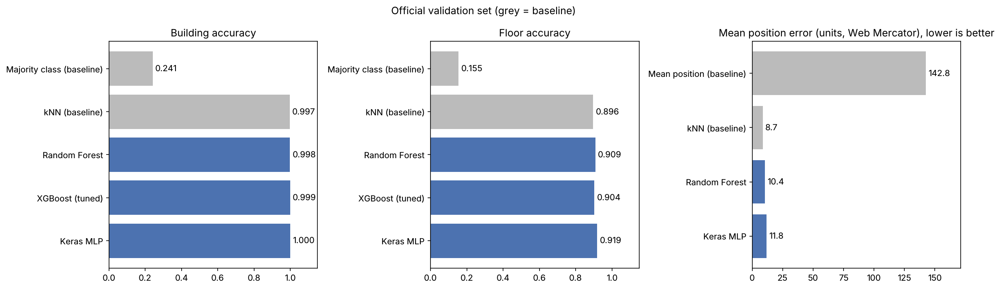

# WiFi Indoor Localization (UJIIndoorLoc)
[](https://github.com/maryam843/wifi-indoor-localization-ujiindoorloc/actions/workflows/ci.yml)

Predicts the building, the floor and the position inside a building from one WiFi scan, using group cross-validation and one final test on 1,111 scans recorded about four months after the training data.

## Key results

All on the official validation file (1,111 scans), used once per final model.

- **Floor:** the Keras MLP gets the floor right for 0.9190 of scans (1,021 of 1,111), against 0.8965 for a kNN baseline and 0.1548 for always guessing the most common floor. 83 of the 90 wrong floors are one floor off.
- **Position:** the simple kNN baseline (k = 4) is the best position model: median error 5.43 units (about 4.2 m on the ground), mean 8.72 units, against 142.75 units for always predicting the mean position. It beat the Random Forest (mean 10.43) and the Keras MLP (mean 11.76).
- **Building:** XGBoost gets 1,110 of 1,111 scans right (0.9991), against 0.2412 for the majority class. Every non-trivial model scores between 0.9973 and 1.0000.
- **Gaps:** the tuned XGBoost was not better than the untuned Random Forest for floor (0.9037 vs 0.9091), and every floor and position model scores worse on the later test file than in group CV (floor, Keras MLP: 0.9766 in CV, 0.9190 on test).



**Tools:** Python, pandas, NumPy, scikit-learn, XGBoost, TensorFlow, Keras, matplotlib, seaborn, Jupyter, pytest, GitHub Actions

## Data

[UJIIndoorLoc](https://archive.ics.uci.edu/dataset/310/ujiindoorloc), UCI Machine Learning Repository dataset #310, licence CC BY 4.0.

- Three buildings of Universitat Jaume I (Castellón, Spain), floors 0 to 4, 520 WiFi access points.
- `trainingData.csv`: 19,937 scans x 529 columns (42.7 MB). `validationData.csv`: 1,111 scans (2.4 MB), recorded about four months later and used here as the test set.
- Each scan holds the signal strength (RSSI) of every access point, from -104 dBm (weak) to 0 dBm (strong); the value 100 means "not detected" (96.5% of all training values).
- Coordinates are Web Mercator metres ("units" below). At this latitude the scale factor is 1.305, so ground metres = units / 1.305.

The CSV files are not committed. The notebook downloads the zip from UCI on its first run; manual steps are in [data/README.md](data/README.md).

## Approach

1. **Encode "not detected" as a signal, not a gap.** 100 becomes -105 dBm, just weaker than any real reading (`src/encoding.py`). Nothing is imputed, because not hearing an access point is location information.
2. **Clean the training file only.** 637 exact duplicates and 73 empty scans are removed (19,227 rows left), and the 55 access points never heard in training are dropped, leaving 465 inputs. The test file keeps all 1,111 rows.
3. **Use only the WiFi signals as inputs.** Timestamp, space ID, building ID, user, phone and the other coordinate are never inputs; longitude and latitude are predicted together.
4. **Group cross-validation.** Scans of the same spot are near copies, so the 735 building-floor-space locations are kept whole in 5-fold group CV. `StableGroupKFold` (`src/folds.py`) gives the same folds on every machine; the fold table is saved in `results/group_folds.csv`.
5. **Compare against baselines.** Majority class, mean position and kNN (k from 1 to 5) run beside a Random Forest, an XGBoost random search (10 candidates for building, 20 for floor, 3-fold group CV) and a Keras MLP, all with the same fixed 0 to 1 signal scaling (nothing is fitted on the data).
6. **Select by group CV, baselines included.** For each task the model with the best group-CV score is chosen: XGBoost for building (0.9994), Keras MLP for floor (0.9766), kNN with k = 4 for position (8.46 units).
7. **Test once.** Each final model is refit on all 19,227 training rows and scored once on the validation file (a `score_once` guard in the notebook), then the errors are broken down by building and floor.

## Results

Official validation file, 1,111 scans. Bold = model selected by group CV for that task. Position errors are 2-D distances in units (Web Mercator metres).

| Model | Building accuracy | Floor accuracy | Floor macro-F1 | Position mean | Position median | Position 90th pct |
|---|---|---|---|---|---|---|
| Majority class / mean position (baseline) | 0.2412 | 0.1548 | 0.0536 | 142.75 | 167.37 | 217.10 |
| kNN (baseline; k = 1 for building and floor, k = 4 for position) | 0.9973 | 0.8965 | 0.8960 | **8.72** | **5.43** | **18.76** |
| Random Forest | 0.9982 | 0.9091 | 0.8962 | 10.43 | 7.65 | 22.38 |
| XGBoost (tuned) | **0.9991** | 0.9037 | 0.8917 | not trained | not trained | not trained |
| Keras MLP | 1.0000 | **0.9190** | **0.9100** | 11.76 | 9.45 | 22.60 |

- kNN position error in ground metres: mean 6.68 m, median 4.16 m, 90th percentile 14.37 m.
- With the usual penalty (4 units per wrong floor, 50 per wrong building, using the selected building and floor models), the kNN mean error is 9.12 units.
- The building choice is a near tie in group CV (XGBoost and Keras MLP both 0.9994); the MLP then scored 1.0000 on test, but the choice was made before testing.
- Floor accuracy by building (Keras MLP): 0.965 in building 0, 0.824 in building 1, 0.937 in building 2. The most common mistakes are in building 1: floor 1 predicted as floor 2 (27 scans) or floor 0 (15 scans).
- Median kNN position error by building: 3.967, 6.786 and 7.524 units.

## Limitations

- One campus and one later test period. Results may not transfer to other buildings, and scores drop from group CV to the test file, likely from signal drift over time, a single collector for the test file, and 55 access points heard only in the test month.
- One seed per model and no repeated runs, so no spread is reported; the floor gap between the Keras MLP and the Random Forest (0.9190 vs 0.9091) is small.
- Errors are 2-D and in Web Mercator units; the ground-metre figures use the derived 1.305 scale factor. Building, floor and position are predicted by separate models, not one hierarchical model.
- The tests cover the two helper modules only. CI does not run the notebook, which needs the download and took 14.6 minutes in the saved run.

## How to run

Python 3.12 or 3.13 (CI uses 3.12).

```bash
git clone https://github.com/maryam843/wifi-indoor-localization-ujiindoorloc.git
cd wifi-indoor-localization-ujiindoorloc
python3.12 -m venv .venv
source .venv/bin/activate        # Windows: .venv\Scripts\activate
pip install -r requirements.txt -r requirements-dev.txt jupyter nbconvert
```

Run the whole pipeline (downloads the data, trains, tests once, writes the figures and the fold table):

```bash
cd notebooks
jupyter nbconvert --to notebook --execute --inplace --ExecutePreprocessor.timeout=3600 wifi_indoor_localization.ipynb
```

Tests and lint, as in CI (from the repo root):

```bash
ruff check .
pytest -v
```

## Repo structure

```text
notebooks/wifi_indoor_localization.ipynb   full pipeline: data, group CV, models, final test, figures, error analysis
src/encoding.py                            "not detected" encoding and 0 to 1 signal scaling
src/folds.py                               StableGroupKFold: the same group folds on every machine
tests/                                     11 pytest tests for the two modules
results/group_folds.csv                    735 location groups and their fold in the 5-fold and 3-fold splits
figures/                                   4 figures written by the notebook
data/README.md                             download steps, file schema, licence and citation (CSVs not committed)
.github/workflows/ci.yml                   CI: ruff lint and pytest on Python 3.12
pyproject.toml                             pytest and ruff settings
requirements.txt, requirements-dev.txt     pinned libraries and test tools
```

## Licence and credits

Code: MIT licence, see [LICENSE](LICENSE).

Dataset: UJIIndoorLoc, CC BY 4.0, via the UCI Machine Learning Repository (dataset DOI 10.24432/C5MS59). It is not redistributed here.

Torres-Sospedra, J., Montoliu, R., Martínez-Usó, A., Avariento, J. P., Arnau, T. J., Benedito-Bordonau, M., & Huerta, J. (2014).
UJIIndoorLoc: A new multi-building and multi-floor database for WLAN fingerprint-based indoor localization problems.
*2014 International Conference on Indoor Positioning and Indoor Navigation (IPIN)*, 261-270. DOI 10.1109/IPIN.2014.7275492.
