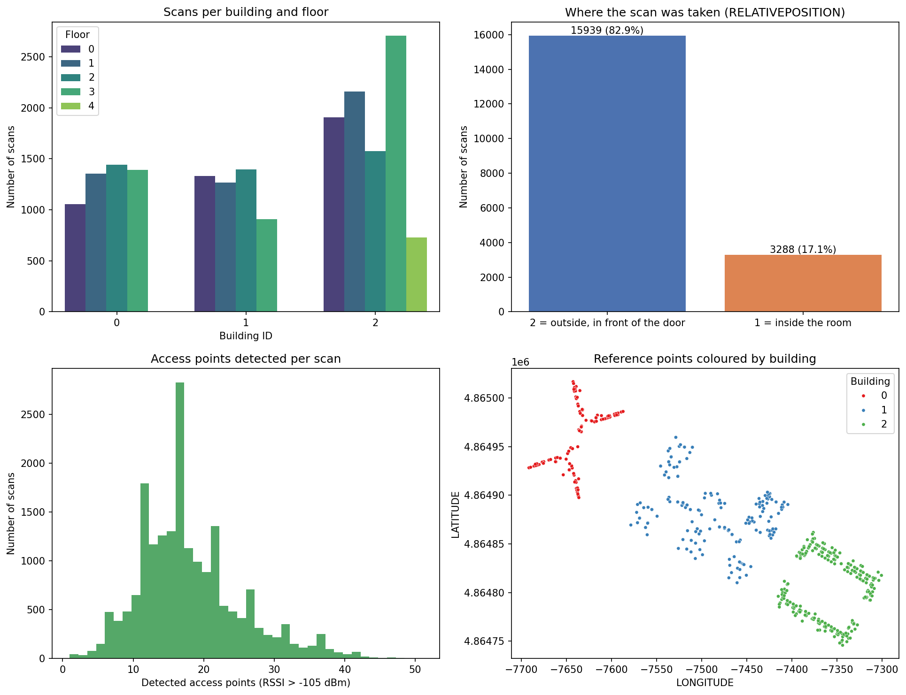
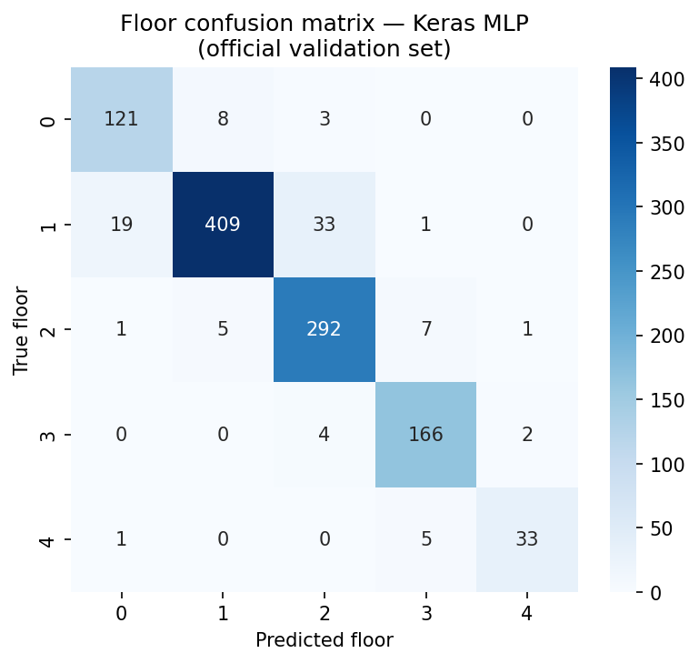
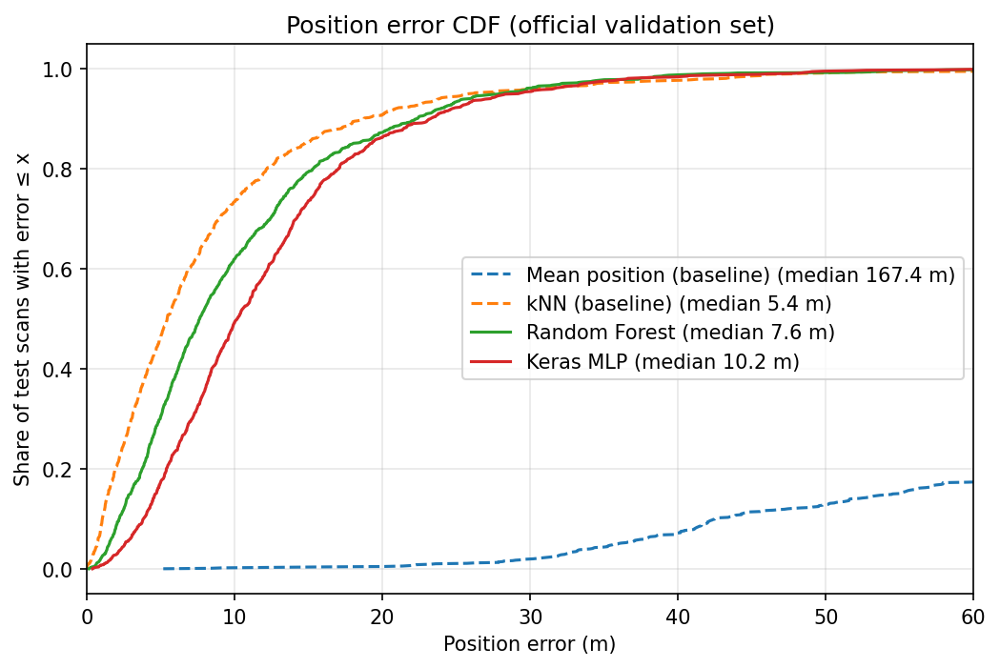

# WiFi indoor localization (UJIIndoorLoc)

## Project in plain English

- GPS does not work well inside buildings, but most buildings are full of WiFi access points.
- A phone's WiFi scan lists how strongly it hears each access point. Each spot in a building has its own pattern, like a fingerprint.
- Input: one WiFi scan (signal strength from up to 520 access points). Output: the building, the floor, and the position in metres.
- On a separate test set recorded about 4 months after the training data, all models except the simplest baseline get the building right in 99.7–100% of
  scans, and the floor in about 90–92%. The typical (median) position error is 5.4 m in the dataset's map units (about 4.2 m on the ground).
- The simplest method, "find the most similar known scan" (k-nearest neighbours), gave the best position accuracy.
- This kind of system is used for indoor navigation, finding people in emergencies, and tracking equipment in large buildings.

This is a two-person course project (DSAI3201 Machine Learning, UDST, Winter 2025). In 2026 I reviewed it, found serious
problems in our original version, and rebuilt the evaluation. Both versions are in this repo.

## Data

[UJIIndoorLoc](https://archive.ics.uci.edu/dataset/310/ujiindoorloc), UCI Machine Learning Repository, dataset #310. Licence: CC BY 4.0.

- 3 buildings of Universitat Jaume I (Spain), 5 floor levels (floors 0–4), 520 WiFi access points.
- Official split: `trainingData.csv` (19,937 scans) and `validationData.csv` (1,111 scans, recorded about 4 months later).
- Signal strength (RSSI) goes from −104 dBm (weakest) to 0 dBm (strongest). The value 100 means "access point not detected".

Torres-Sospedra, J., Montoliu, R., Martínez-Usó, A., Avariento, J. P., Arnau, T. J., Benedito-Bordonau, M., & Huerta, J. (2014).
UJIIndoorLoc: A new multi-building and multi-floor database for WLAN fingerprint-based indoor localization problems.
*2014 International Conference on Indoor Positioning and Indoor Navigation (IPIN)*, 261–270.

The data is not stored in this repo. The notebook downloads it from UCI (details in [data/README.md](data/README.md)).

## What we built in the course (2025)

[`notebooks/01_original_course_version.ipynb`](notebooks/01_original_course_version.ipynb) is the notebook we submitted.
Only personal details and outputs showing local paths were removed; it was not re-run. We trained Random Forest and XGBoost
classifiers for building and floor, and a Random Forest and a Keras neural network for the coordinates, using a random
80/20 split of the training file.

## What was wrong in the first version and how I fixed it

| Problem | Fix |
|---|---|
| **Leakage in the position models.** To predict latitude we gave the model the longitude (and the other way round), plus the timestamp, space ID, building ID and relative position. None of these are known when all you have is a WiFi scan, so the tiny errors (about 0.5 m) came from the model reading the answer from its inputs. The first version's position results are not valid. | The only inputs are the WiFi signal columns. Longitude and latitude are predicted together. |
| **"Not detected" turned into "normal signal".** We correctly saw that 100 is not a real signal. But then we dropped 465 of the 520 access points (those missing in more than 90% of scans) and filled the remaining gaps with the median or mean. That erased most of the location information. | Keep every access point that is ever detected in training (465 of 520; 55 are never detected) and encode 100 as −105 dBm, just weaker than any real reading. No imputation. |
| **Random split only.** Almost identical scans of the same spot ended up in both train and test, and the official validation file was never used. | Group cross-validation for all choices and a single final test on the official validation file (see below). |
| **No baselines.** | Majority class, k-nearest neighbours (kNN) and "always predict the average position". |
| **No tuning.** `GridSearchCV` was imported but never used, although our report said we tuned. | Random search for XGBoost (20 settings for floor, 10 for building) and a group-CV search over k for kNN. |
| **Chart and code bugs:** swapped pie-chart labels (83% of scans were taken *outside* the room, in front of the door, not inside), a bar showing the wrong model, blank saved figures (`plt.show()` before `savefig`), a cell that only ran because of leftover variables, and the scaler fitted before the split. | Correct labels, charts built from the results table, figures saved before showing, a notebook that runs top to bottom, and a fixed signal transform inside sklearn Pipelines. |

## How I evaluated

- Every choice (k for kNN, XGBoost settings, which model counts as "selected") uses only `trainingData.csv`, with 5-fold
  **group cross-validation**. A group is one reference location (building + floor + space; 735 groups), so all scans of a
  spot are held out together.
- The official `validationData.csv` is the **final test set**. It is used in one section of the notebook, and each final
  model is scored on it exactly once. Keras early stopping uses a split of the training data only.
- Position error is the straight-line (2-D) distance between the true and predicted point. It is in the dataset's own units,
  as in other work on this dataset. The coordinates are Web Mercator (EPSG:3857-like) metres; the notebook computes a scale
  factor of 1.305 at this latitude, so ground distances ≈ 0.766 × these values. The main position table uses dataset units;
  a second table gives approximate ground metres.

## Results

All numbers come from the executed notebook [`02_corrected_version.ipynb`](notebooks/02_corrected_version.ipynb)
(section 7 for the test set, section 6 for group CV). Official validation set, 1,111 scans.

**Building**

| Model | Test accuracy | Group-CV accuracy (train) |
|---|---|---|
| Majority class (baseline) | 0.2412 | 0.4721 |
| kNN, k = 1 (baseline) | 0.9973 | 0.9979 |
| Random Forest | 0.9982 | 0.9985 |
| XGBoost (tuned) | 0.9991 | 0.9993 |
| Keras MLP (selected by group CV) | 1.0000 | 0.9998 |

**Floor**

| Model | Test accuracy (floor hit rate) | Macro-F1 | Building and floor both correct | Group-CV accuracy (train) |
|---|---|---|---|---|
| Majority class (baseline) | 0.1548 | 0.0536 | 0.0360 | 0.2476 |
| kNN, k = 1 (baseline) | 0.8965 | 0.8960 | 0.8965 | 0.9676 |
| Random Forest | 0.9091 | 0.8962 | 0.9082 | 0.9724 |
| XGBoost (tuned) | 0.9037 | 0.8917 | 0.9037 | 0.9733 |
| Keras MLP (selected by group CV) | 0.9190 | 0.9100 | 0.9190 | 0.9816 |

**Position** (error in metres, dataset units = Web Mercator metres)

| Model | Mean | Median | 75th pct | 90th pct | Group-CV mean (train) |
|---|---|---|---|---|---|
| Mean position (baseline) | 142.75 | 167.37 | 193.37 | 217.10 | 129.98 |
| **kNN, k = 4 (baseline) — final position model** | **8.72** | **5.43** | **10.46** | **18.76** | **8.45** |
| Random Forest (auto-selected, non-baselines only) | 10.43 | 7.65 | 13.52 | 22.38 | 8.66 |
| Keras MLP | 12.26 | 10.17 | 15.44 | 23.27 | 9.87 |

**Position, ≈ ground metres** (dataset values ÷ 1.305, the scale factor printed by the notebook)

| Model | Mean | Median | 75th pct | 90th pct | Group-CV mean (train) |
|---|---|---|---|---|---|
| Mean position (baseline) | ≈ 109.39 | ≈ 128.26 | ≈ 148.18 | ≈ 166.36 | ≈ 99.60 |
| **kNN, k = 4 (baseline) — final position model** | **≈ 6.68** | **≈ 4.16** | **≈ 8.02** | **≈ 14.37** | **≈ 6.47** |
| Random Forest | ≈ 7.99 | ≈ 5.86 | ≈ 10.36 | ≈ 17.15 | ≈ 6.64 |
| Keras MLP | ≈ 9.39 | ≈ 7.79 | ≈ 11.83 | ≈ 17.83 | ≈ 7.56 |

**The kNN baseline (k = 4) is the best position model**, both in group CV (8.45 m) and on the official validation set
(mean 8.72 m, median 5.43 m), ahead of the Random Forest (10.43 m) and the Keras MLP (12.26 m). The notebook's automatic
selection only compared non-baseline models, so it marked the Random Forest as "selected". I report kNN as the final
position model.

What I take from this:
- Building prediction is basically solved by every model except the majority baseline.
- For the floor, the models beat kNN by 0.7–2.3 percentage points. The Keras MLP is best (91.9%).
- For position, the simple kNN baseline beat every more complex model (see above).
- Test scores are lower than group-CV scores (for example, floor 0.98 → 0.92 for the MLP). The test data was recorded
  about 4 months later, and signals change over time, which likely explains most of the gap.
- XGBoost (tuned), which I focused on, was not better than the untuned Random Forest on this data.

Best XGBoost settings from the random search (3-fold group CV):
`n_estimators=291, max_depth=6, learning_rate=0.2799, subsample=0.9969, colsample_bytree=0.2124, min_child_weight=2`.
Both XGBoost searches (building and floor) used the same random seed, so they share this best setting.

### First version vs corrected version

| Task, model | First version (course, 2025) | Corrected (official validation set) |
|---|---|---|
| Building, Random Forest | 0.9876 accuracy (random split) | 0.9982 accuracy |
| Building, XGBoost | 0.9865 accuracy (random split, not tuned) | 0.9991 accuracy (tuned) |
| Floor, Random Forest | 0.8108 accuracy (random split); 0.6710 in 5-fold CV | 0.9091 accuracy, macro-F1 0.8962 |
| Floor, XGBoost | 0.8072 accuracy (random split); 0.6817 in 5-fold CV | 0.9037 accuracy, macro-F1 0.8917 |
| Position, Random Forest | RMSE 0.53 m (lat) / 0.68 m (long): **invalid, leakage** | mean 2-D error 10.43 m (median 7.65 m) |
| Position, Keras MLP | RMSE 8.32 m (lat) / 7.97 m (long): **invalid, leakage** | mean 2-D error 12.26 m (median 10.17 m) |

**Different test sets — not a like-for-like comparison.** The first version was scored on a random 80/20 split of the
training file; the corrected version on the official validation set, recorded about 4 months later.

The first-version numbers are copied from the saved outputs of the course notebook. After the fixes, floor accuracy went
from about 81% (on an easier random split) to about 90–92% on the harder, later test set. The main change is the
"not detected" encoding. The best corrected position model, kNN (not in the first version), reaches a mean error of 8.72 m.

## Figures

Data overview (training file): scans per building and floor, where scans were taken, access points heard per scan, and reference points.



Floor confusion matrix of the selected model (Keras MLP) on the official validation set:



Position error, cumulative distribution on the official validation set:



All models vs baselines on the official validation set:


Position errors in both figures are in dataset (Web Mercator) units.

Cosmetic notes: Colab did not save execution counts in the notebook (the outputs are all there), and in `model_comparison.png`
the value labels near 1.0 overlap the plot border. Neither affects any result.

## Limitations

- One campus and one data collection campaign; the results may not transfer to other buildings.
- Different phones measure signal strength differently, and I did not correct for that.
- WiFi signals change over time. The test data is only about 4 months newer than the training data.
- Floor mistakes (Keras MLP) are concentrated in building 1. There, floor accuracy is 0.824, against 0.965 in building 0 and 0.937 in
  building 2. The most common mistakes are floor 1 predicted as floor 2 (27 scans) or floor 0 (15 scans). 83 of the 90 wrong
  floor predictions are off by one floor.
- Position error grows from building 0 (median 5.95 m) to building 1 (8.86 m) and building 2 (12.39 m) for the Random Forest.
- Errors are reported in Web Mercator units; ground metres are only approximate (÷ 1.305, see "How I evaluated").
- A hierarchical model (building first, then floor, then position within that building) was not tried.
- The notebook took 45.0 minutes on the free Colab CPU runtime, mostly the XGBoost random search.

## What I learned

- If a result looks too good, check the inputs first. Our 0.5 m error came from giving the model the answer.
- Missing values are not always "unknown". Here, "not detected" is real information, and filling it with the average destroyed it.
- How you split the data matters as much as the model. Random splits of repeated measurements overstate accuracy, and a
  later, separate test set gives a more honest number.
- A simple, well-tuned baseline can beat more complex models. kNN with k chosen by group CV was hard to beat for floor,
  and for position it beat both the Random Forest and the neural network. Always include one.

## How to run

**Google Colab.** [Open in Colab](https://colab.research.google.com/github/maryam843/wifi-indoor-localization-ujiindoorloc/blob/main/notebooks/02_corrected_version.ipynb),
then Runtime → Run all. The notebook downloads the data from UCI. It takes about 45 minutes on the free Colab CPU
(mostly the XGBoost search).

**Locally** (Python 3.10–3.13):

```bash
python -m venv .venv
.venv/Scripts/activate        # macOS/Linux: source .venv/bin/activate
pip install -r requirements.txt jupyter
jupyter notebook notebooks/02_corrected_version.ipynb
```

## Repo structure

```
README.md
LICENSE
requirements.txt
data/README.md                           download steps and citation (CSV files are not committed)
figures/                                 figures produced by the corrected notebook
notebooks/01_original_course_version.ipynb   course version (2025), kept for transparency, not re-run
notebooks/02_corrected_version.ipynb         corrected version (2026), executed in Google Colab
```

## Credits and licence

A two-person course project for DSAI3201 Machine Learning, UDST, Winter 2025. The corrected 2026 version was done by one
member of the team.

Dataset: UJIIndoorLoc by Torres-Sospedra et al. (2014), CC BY 4.0, via the UCI Machine Learning Repository. It is not redistributed here.

Code: MIT licence (see [LICENSE](LICENSE)).
